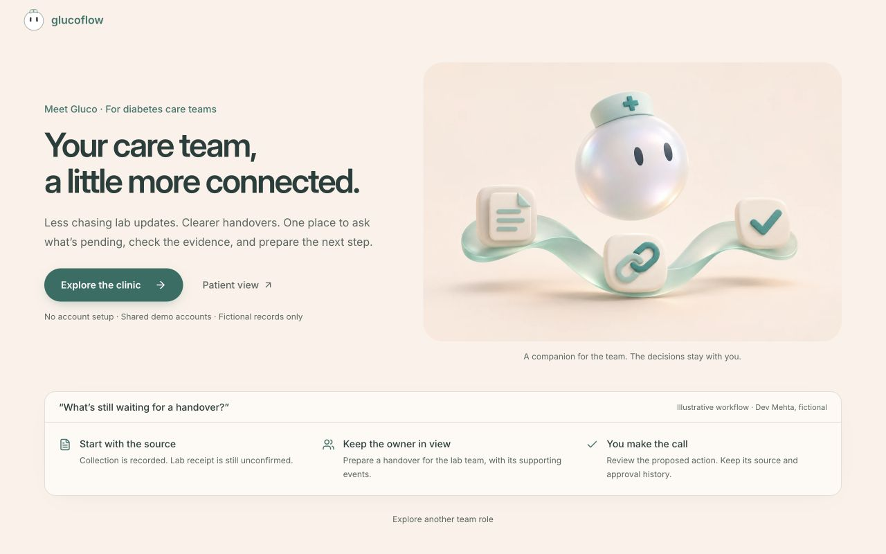

# GlucoFlow

A care coordination companion for diabetes teams. Gluco helps staff see what is pending, find its source, prepare a handover, and keep responsibility visible across departments.

**[Explore the demo](https://glucoflow.vercel.app/)** · [Local setup](app/docs/SETUP.md) · [Agent and deployment setup](app/docs/CARE_SETUP.md) · [Hospital staff setup](app/docs/HOSPITAL_SETUP.md) · [Demo walkthrough](app/docs/CARE_DEMO.md) · [Shipping checklist](app/docs/SHIP_CHECKLIST.md)



## What the product does

Start with the care desk or ask Gluco a question. Responses bring relevant encounter cards, owners and source evidence into the conversation. Staff can inspect the evidence and approve a bounded operational action without hunting through disconnected screens.

- **Shared work:** follow orders, specimen receipt, result acknowledgement and handovers across synthetic encounters. Missing evidence stays unverified.
- **Useful conversations:** live action progress, concise responses, evidence drawers, Enter to send, Shift+Enter for a newline, cancellation, microphone input and read-aloud controls. Speech requires a configured Sarvam service.
- **Human control:** actions require authorization and approval. Viewing a result does not silently acknowledge it. Source events and human attestations remain distinguishable.
- **Care routines:** versioned operational templates with evaluation, clinician approval and rollback. Applying a routine uses the target encounter's own evidence. This is bounded workflow reuse, not autonomous medical learning.
- **Coordination:** capacity-confirmed staff offers, identity-bound receiving-team acceptance, renewable staff shifts, and source-linked follow-up. The evidence pipeline keeps order completion, result acknowledgement and bed placement separate. See the [pipeline diagrams](app/docs/CARE_PIPELINE.md).
- **Team access:** hospital administrators activate operator-provisioned staff and assign Care roles. Workspace owners enroll named colleagues within those permissions. Revocation is checked on every request; administration does not imply clinical-record access. Private demos provide multiple named fictional people per role. Sign out is at the top right.
- **Continuity:** saved workspaces, durable source-bearing revision history, explicit same-clinic team membership, and read-only archives linked to fresh simulations.
- **Patient records:** upload and review workflows, source-linked records, patient notes and exports. The web client also supplies the Capacitor Android shell.

The public demo uses shared accounts and fictional records only. Select **Explore the clinic** or **Patient view** on the landing page. Do not upload real patient information.

## Scope and readiness

GlucoFlow assists operational work. It does not diagnose, prescribe, calculate clinical risk, decide ICU admission, or replace clinical judgment. DKA/HHS provides the coordination context; treatment protocols are not executable agent skills.

HIS/LIS are intentionally simulated for the demo; real connectors are not a demo acceptance requirement. ABHA/ABDM remains unconnected. Cross-team testing uses fictional records against the actual UI, API, worker and database; see the [cross-team verification](app/reports/cross-team-application-2026-11-07.md).

The deployed demonstration is not a certified hospital production system. Live HIS/LIS connectors, ABHA/ABDM registration, hospital security and privacy review, reviewed regional language coverage, physical Android regression, and a real clinic pilot remain separate release gates. Simulated usage is not clinical validation. See the [release report](app/reports/completion-release-2026-11-07.md) and [PDF scope audit](app/reports/pdf-compliance-audit-2026-11-07.md).

## Run locally

Requires Node 22.12–22.x, pnpm 12.5.1 and PostgreSQL 16. From a new checkout:

```sh
cd app
pnpm install
cp .env.example .env # only if .env does not already exist
pnpm db:start
pnpm db:migrate
pnpm fixtures:generate
pnpm fixtures:reference
pnpm seed:demo -- --clinic demo --confirm-demo
pnpm dev
```

Open http://127.0.0.1:5173. The API runs on port 8787. Local generated demo credentials are saved in ignored `.local/demo-credentials.json`. Run seed/reset commands only against a disposable local demo database.

The [setup guide](app/docs/SETUP.md) covers prerequisites and document processing. The [care setup guide](app/docs/CARE_SETUP.md) adds the Gluco runtime and provider credentials. Without a provider, the explicitly labelled deterministic helper supports model-free exploration; it is not presented as live AI.

## Architecture and deployment

| Layer | Implementation |
| --- | --- |
| Interface | React, TypeScript, Vite; Capacitor Android shell |
| API | Fastify, server-side authorization, bounded streamed progress |
| Data | PostgreSQL, migrations, durable jobs, source evidence and audit history |
| Processing | Separate worker for documents and exports |
| Gluco runtime | Pinned, bundled agent source plus application-specific tools and validation |
| Hosted demo | Vercel web; Azure Container Apps API, worker and private runtime sidecars; Supabase services |

Application code lives in [`app/`](app/README.md). Container definitions, Compose configuration, example environment files and deployment scripts are included. The runtime source archive, checksum, license and provenance are committed: building it does **not** clone an upstream agent repository. Package installation, base images and configured AI/speech providers still require network access; this is not an air-gapped bundle.

Follow [CARE_SETUP.md](app/docs/CARE_SETUP.md) for local containers and Azure/Vercel deployment. Existing compatibility environment names and upstream module identifiers are retained where needed; never rename them independently of their consumers. Keep all credentials server-side and out of source control.

## Verification

The latest 7 November PDF workflow run passed **419 tests across 78 files**; see the [current release evidence](app/reports/pdf-final-four-release-2026-11-07.md). Runtime and source-bundle checks are recorded separately in the [release report](app/reports/completion-release-2026-11-07.md). Typechecking, client builds and desktop/mobile landing checks accompany the UI release.

One hosted synthetic handover produced its first progress event in **339 ms** and its final result in **9.626 seconds**. That is a single observation, not a latency guarantee or a load-test percentile. See the [timing trace](app/reports/gluco-hosted-progress-2026-11-07.json).

```sh
cd app
pnpm typecheck
pnpm test
pnpm build
pnpm db:test
pnpm lint:ui --json
```

Each command has its own environment requirements; database and browser checks need running services. Historical reports are dated evidence, not proof that every current route has been retested.

## Product documents and credits

Active scope: [product specification](docs/mvp/01-product.md), [build plan](docs/mvp/06-build-plan.md), [acceptance mapping](docs/mvp/10-acceptance-checklist.md), and [completion plan](app/docs/COMPLETION_PLAN.md). Archived handoffs remain historical references.

GlucoFlow draws interaction inspiration from OpenAI Dots and Codex, and builds on the Hermes Agent runtime. Upstream licenses and provenance are preserved with the bundled source. The orb adapts the credited grok-bot-emoji vectors; no affiliation or endorsement is implied. The new landing illustration was generated for this project; its [source prompt and assets](app/apps/client/public/brand/README.md) are included.

### PDF demo workflow additions

The workspace now supports one approved shift-monitoring scope, nurse My Shift, a source-backed lab queue, editable versioned handover with named receipt, and reachable appointment and unit-workload previews. Find the previews and monitoring under the workspace menu; assigned recipients see pending handovers on their care desk.

These are bounded synthetic workflows. A persistent 90-day simulation reached retained-history limits (8 handover drafts, 12 monitors per workspace, 12 soft acknowledgements per task). Archive/new simulation is not continuation of real patient care. Durable paginated history and a hospital-approved retention model remain necessary before sustained hospital deployment. See the [Terra longitudinal report](app/reports/terra-longitudinal-2026-11-07.md).
