# GlucoFlow web journeys and operational memory

This is a synthetic coordination prototype. The supplied 26-page blueprint remains the product direction; its hospital deployment, clinical governance and comparative novelty claims are not validated by a working demo. The November 7 web audit adds governed template reuse without enabling diagnosis or treatment learning.

## Navigation by user goal

| Goal | Start | Next action | Completion evidence |
| --- | --- | --- | --- |
| Understand outstanding inpatient work | Care → Ask | Ask about a named encounter; inspect a cited source or episode | Current simulated HIS/LIS event, timestamp and freshness |
| Delegate a bounded operational task | Care → My Worklist | Review the target, owner, completion condition and expiry; approve | A matching independent simulator event, or separately labelled human attestation |
| Investigate what happened | Care → My Activity | Open a task, its source or its episode | Persisted task actions and source references |
| Prepare a shift handover | Care → My Care Teams | Inspect encounter context and draft a scoped handover | Reviewable draft with source references; no external transmission |
| Reuse a confirmed workflow | Completed task → Capture → Workflow learning | Test, clinician-review and publish a fixed operational template; preview on another encounter | New encounter's prerequisite evidence and a new task awaiting human approval |
| Resume an earlier exercise | Care → Saved workspaces | Reopen an owner-authorized workspace | Persisted workspace and its own transcript, tasks and events |
| Review longitudinal records | Patient records | Select a patient → overview, source documents, progression or history | Clinician-approved recorded facts; separate from the inpatient simulator cohort |
| Close a result follow-up | Result closure | Clinician review → patient calls/lab intake → closure register | State-specific event chain; unreachable is not contacted or completed |
| View personal records | Patient account | Records, home readings, add report, visit notes | Authorized patient record; no access to clinic care workspaces |

The episode URL preserves the current care area and adds `encounter=<id>`. Browser Back returns to the prior area. A source event can open the same episode, avoiding a second independent patient context.

## Data and authority flow

```mermaid
flowchart LR
  S[Simulated HIS and LIS events] --> W[Owner-scoped encounter workspace]
  W --> R[Authorized source read]
  R --> H[Bounded Hermes turn]
  H --> P[Validated operational proposal]
  P --> A[Human task approval]
  A --> T[Time-bounded task]
  S --> C[Exact matching completion evidence]
  T --> C
  C --> D[Staff captures fixed procedure draft]
  D --> X[Sandbox positive and negative cases]
  X --> G[Authenticated clinician approval]
  G --> L[Clinic-scoped versioned template library]
  L --> B[Fresh encounter B prerequisite check]
  B --> P
```

The shared library contains controlled operational procedure fields. Patient notes, diagnoses, names, conversation transcripts and A's completion event are not copied into B. Private origin pointers remain access-controlled. A shared template never grants access to its author's workspace.

## What “improvement” means in this release

There are three distinct stores: source-attributed encounter state, task/conversation state, and a versioned operational template library. Handover layout preferences are a fourth small presentation setting, not medical learning. Published templates describe known coordination patterns; the agent does not invent executable medical procedures or update its own weights.

A useful demo is: complete a specimen receipt for A, capture the verified pattern, run the sandbox, approve it, then preview it for B. B must have its own collection evidence, no receipt yet, a current feed and an eligible order. The resulting task remains pending approval. Show rejection on a wrong-stage order, interruption on a stale feed and restoration of an earlier skill version. Those failures demonstrate boundaries as well as the successful path.

This is governed operational reuse. It is not unrestricted self-evolution or general collective medical intelligence. Continuous automatic discovery, institutional review and measured workflow gains remain later work.

## Failure and cost behavior

Keep the source/task state machine deterministic. Use the model to interpret requests and select permitted read/proposal intents. Every turn has finite tool, token and wall-clock budgets. A provider failure must leave the task unchanged, explain the failure and retain the user's draft. The explicitly selected deterministic helper is labelled; it is never presented as a live model response.

Current interactive provider configuration is GPT-6 Luna. Sol and DeepSeek are candidates for a matched evaluation, not automatic upgrades. Their model names, APIs, reasoning support and current prices must be checked together. See the dated public-skills/model audit for source-backed recommendations.

Monitoring currently reconciles on API reads and source commands, with visible-page refresh. It does not claim durable background polling while all users are away. Public demo accounts are shared identities; synthetic workspaces are scoped to the signed-in actor, not private to each visitor using that same account.
