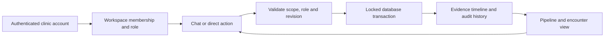
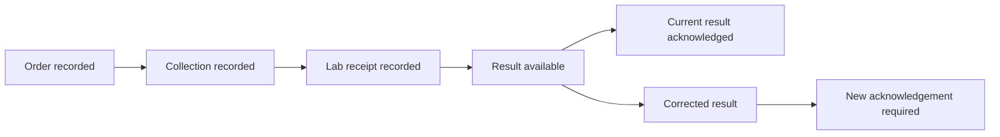
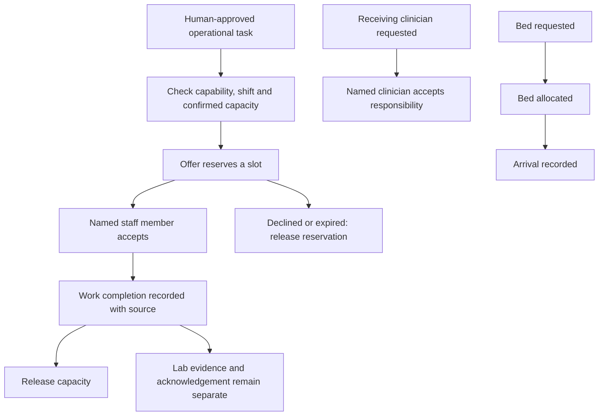

# Care coordination pipeline

GlucoFlow assists operational follow-up. The demo uses fictional records. A displayed stage means a recorded fact, not proof of clinical quality or treatment effectiveness.

Stages are displayed independently. Later lab evidence can arrive before collection evidence; the earlier stage stays unverified. A duplicate source reference is a replay only if its payload matches. A cancelled order can receive late evidence without restarting its task.

Workspace owners can add existing active clinic accounts through **Team**, assign Doctor, Nurse, Lab staff or Coordinator, and revoke access. Doctor access requires existing clinician eligibility. This is workspace enrollment, not account creation or an email invitation. Shared workspaces bind actions to the authenticated user; the private demo's role selector cannot impersonate a member in a shared workspace.

**Pipeline** opens all encounter stages. **Coordinate** opens staff offers, receiving responsibility, placement and sourced records. Signing out is available at the workspace's top right.

Current scale is bounded by workspace storage limits and measured demo load. Hospital rollout still requires identity provisioning, validated connectors, monitoring, recovery verification and a supervised operational pilot. The app does not promise unlimited concurrent staff.
