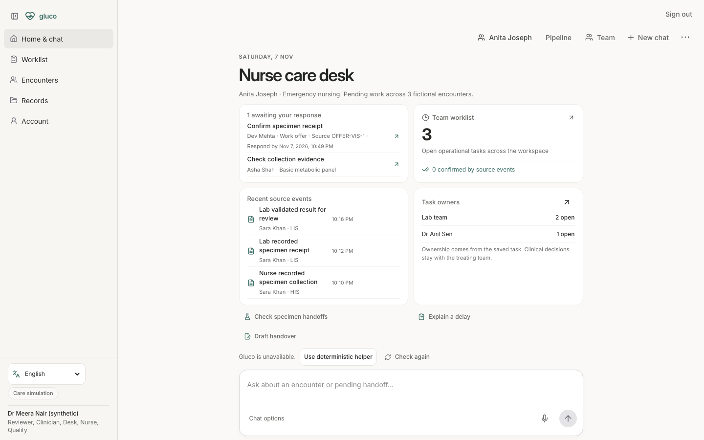
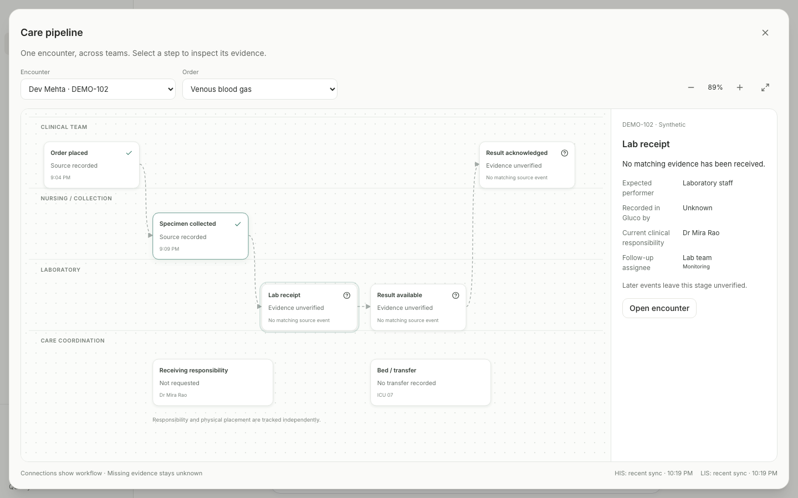
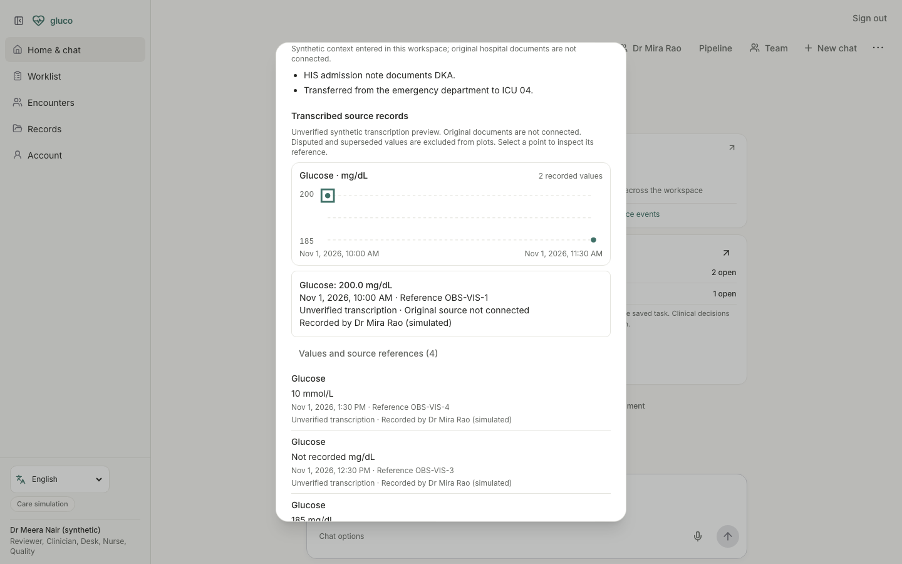

# Hospital authority and visual workflow release — 7 November 2026

## Implemented

- Managed hospital directory, operator-verified identity provisioning, administrator assignment/revocation/audit, last-admin protection and stale-edit conflict recovery. Care membership does not create patient-record access.
- Multiple named fictional people per role. Personal offers and handovers take priority on the care desk. Shared workspaces cannot impersonate demo people.
- Recipient-bound task acceptance, recorded admission/event actors, explicit unassigned admitting team, shift renewal clearing capacity, and audited operator recovery for an orphaned workspace.
- Pipeline differentiates expected performer, actual Gluco recorder, clinical owner and follow-up assignee. Open encounter reaches the episode; source buttons reach recorded evidence.
- Episode numerical plots require compatible labels, units and explicit timestamps; dimensionless values are explicit. Multiple analytes can share a report. Corrections/disputes preserve original versions and exclude superseded/disputed points. These are unverified synthetic transcriptions; original hospital documents are not connected.
- Selected hospital context persists through Care navigation and new-workspace creation.

## Fresh verification

- Full Vitest suite: **406 passed across 76 files** (15.03 seconds).
- TypeScript and complete client/API/worker build: passed.
- Database isolation/constraint checks: **12 passed**.
- Hospital UI browser fixtures: **4 passed**, desktop 1440×900 and mobile 390×844, including activation, revocation, audit, care-only access and shared-workspace entry. These mock APIs; separate real API integration tests verify authorization.
- Real local browser checks: **6 distinct desktop/mobile cases passed** across pipeline source inspection, named-person work and episode chart inspection/correction/dispute. Additional desktop handover/shift-renewal smoke passed.
- Parent manual browser check: private workspace creation, nursing persona switch, pipeline stage inspection and Open encounter navigation.
- Synthetic operator provisioning and orphan recovery smoke tests passed; hosted identity provisioning was not exercised.
- Diff whitespace check passed.

## Independent simulated review

Two doctor-perspective reviews and one technical review identified missing shift renewal, stale administrator updates, incorrect pipeline navigation, generic role queues, and transcription integrity gaps. These were addressed and verified. Workflow re-review: **7.5/10 for the synthetic demo**, with long populated episode lists remaining a usability concern. These agents are not practising doctors; their review is not clinical validation.

- [Workflow judge](doctor-workflow-judge-2026-11-07.md)
- [Integrity judge](doctor-integrity-judge-2026-11-07.md)
- [Technical judge](technical-judge-2026-11-07.md)
- [Reference/scope reconciliation](hospital-authority-reference-review-2026-11-07.md)

## Remaining gates

Hospital deployment still requires verified institutional identities, institution-specific role governance, privacy/security and operational review, live connector validation, clinically reviewed source policies, monitored pilot evidence and physical Android regression. No ABDM connection, eMAR connector, treatment recommendation, historical treatment-ranking claim or clinical outcome improvement is introduced. A synthetic 60–90-day simulation is not a real-world pilot.

## Screenshots

